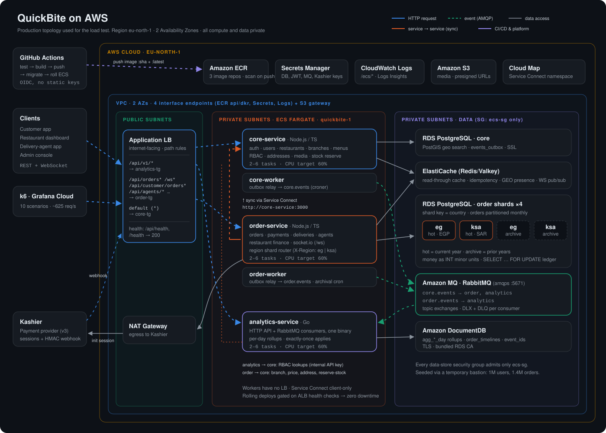
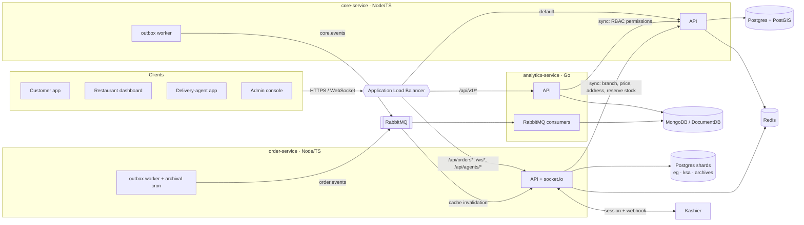
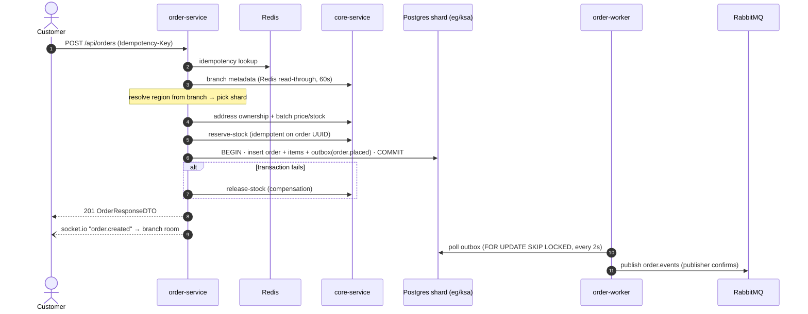
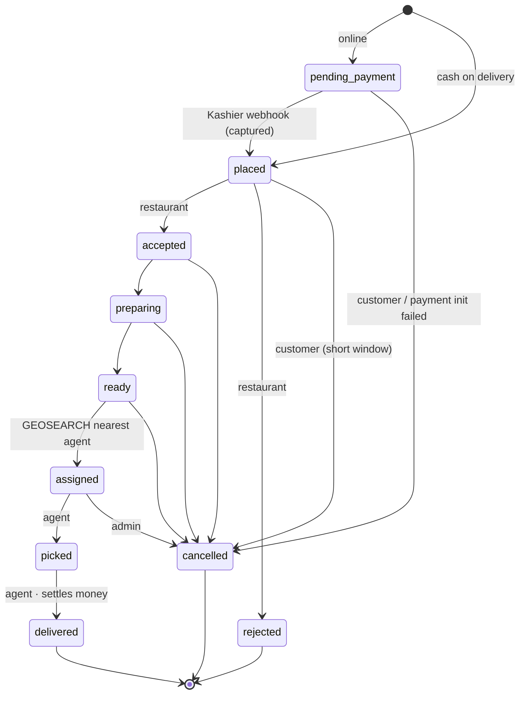
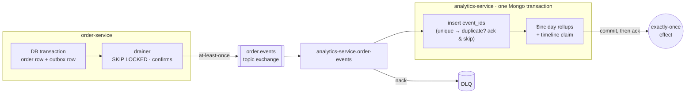
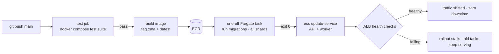

<div align="center">



<br/>


**[Architecture](#-architecture)** · **[Load test](#-load-test-results)** · **[Services](#-the-three-services)** · **[Engineering decisions](#-engineering-decisions)** · **[Run it](#-run-it-locally)** · **[Deployment](#%EF%B8%8F-deploying-to-aws)**

</div>

---

## What is QuickBite?

QuickBite is the backend for a food-delivery platform, similar in scope to Talabat or Uber Eats. It serves four kinds of users: **customers** browse menus and order food, **restaurants** manage menus and process orders, **delivery agents** pick up and deliver, and **admins** run the platform. The platform runs in two countries, **Egypt (EGP)** and **Saudi Arabia (SAR)**.

It is built as **three independently deployable microservices** in two languages. The full stack was deployed to **AWS ECS Fargate** and seeded with **1M users and 1.4M orders**. It then took a **~10-minute open-model load test of 374,400 requests with exactly one failure**.

| | |
|---|---|
| 🧩 **3 microservices** | Node.js/TypeScript ×2 + Go, each with its own database, repo, Dockerfile and CI/CD pipeline |
| 🌍 **Region-sharded orders** | One PostgreSQL cluster per country, plus a cold archive cluster for each |
| 📨 **Event-driven** | Transactional outbox → RabbitMQ → **exactly-once** analytics aggregation |
| ⚡ **Real-time** | socket.io with a Redis adapter pushes live order and delivery status to every client app |
| 💳 **Payments** | Kashier v3 online payments (HMAC-verified webhooks) plus cash on delivery, with a double-entry-style ledger |
| 🚀 **Production-deployed** | ECS Fargate, ALB path routing, Service Connect, RDS, ElastiCache, Amazon MQ, DocumentDB |
| ✅ **600+ automated tests** | Unit + integration (real Postgres, Redis, RabbitMQ, Mongo in Docker); CI fails below 80% coverage |

---

## 🏗 Architecture



**How a request moves through the system:**

1. A single internet-facing **Application Load Balancer** routes by path: `/api/v1/*` goes to analytics, order paths (`/api/orders*`, `/api/agents/*`, `/ws*`, …) go to order-service, and everything else goes to core-service.
2. Services call each other **synchronously** over **ECS Service Connect** (`http://core-service:3000`), staying inside the VPC. Hot lookups are cached in Redis.
3. Domain changes travel **asynchronously**. Each Node service writes an event row in the **same DB transaction** as the business change. A separate **worker** relays that row to RabbitMQ (`core.events`, `order.events`).
4. **analytics-service** (Go) consumes `order.events` and folds them into per-day rollups in DocumentDB. Dashboards read those rollups.

<details>
<summary><b>🔎 Logical view: who talks to whom (click to expand)</b></summary>



</details>

---

## 📈 Load test results



The test ran on **Grafana Cloud k6** against the live AWS deployment. The target was **~54M requests/day (≈625 req/s)**, including **~200k orders/day** split across both country shards.

| Metric | Result | Threshold |
|---|---:|---:|
| Total requests | **374,400** | — |
| HTTP failures | **1** (0.0003%) | < 1% |
| Peak throughput | **643.83 req/s** | target 625 |
| p95 response time | **140 ms** | < 800 ms |
| Virtual users allocated | 340 | — |
| Scenarios | 10 (core browse, nearby, order placement, order history) | — |

**Why the numbers are meaningful:**

- **Open model.** Every scenario uses `constant-arrival-rate`, so k6 sends at a fixed rate no matter how fast the server answers. A struggling system shows up as rising latency and dropped iterations. In this run, achieved rates stayed within 2% of target (for example, `categories` hit 29.5/30 req/s and `customer_orders_eg` hit 21.64/22).
- **Realistic dataset.** Seed scripts loaded **1M users, 1,000 restaurants, 3,000 branches, 80K products, 1.4M historical orders and ~2.2M analytics documents**. They use a deterministic ID scheme, so the test builds valid references with arithmetic instead of lookups.
- **The write path is real.** Each `POST /orders` call checks the branch, address ownership and prices against core-service, **reserves stock**, writes to the correct country shard and emits an outbox event.

<details>
<summary><b>Traffic mix and how to reproduce it</b></summary>

| Scenario | Endpoint | Target req/s | Service |
|---|---|---:|---|
| `menu_items` | `GET /api/branches/:id/products` | 300 | core (Redis-cached, hottest path) |
| `restaurants_list` | `GET /api/restaurants` | 90 | core |
| `restaurant_branches` | `GET /api/restaurants/:id/branches` | 70 | core |
| `nearby` | `GET /api/branches/nearby` (PostGIS) | 60 | core |
| `restaurant_detail` | `GET /api/restaurants/:id` | 40 | core |
| `categories` | `GET /api/restaurants/:id/categories` | 30 | core |
| `customer_orders_eg` | `GET /api/customer/orders` · eg | 22 | order |
| `customer_orders_sa` | `GET /api/customer/orders` · ksa | 10 | order |
| `orders_eg` | `POST /api/orders` · eg | 1.6 | order (~140k/day) |
| `orders_sa` | `POST /api/orders` · ksa | 0.7 | order (~60k/day) |

```bash
k6 cloud login --token <GRAFANA_CLOUD_K6_TOKEN>
k6 cloud run -e ALB_URL=http://<your-alb> -e ACCESS_SECRET=<ACCESS_SECRET> -e DURATION=10m loadtest.js
```

The script mints HS256 access tokens in-script, using the same claim shape the services issue, so it can spread load across 50,000 seeded customers without a login round-trip. Seeds and the script are in the order-service repo under [`loadtest/`](https://github.com/markisaac1812/quickbite_order_service/tree/main/loadtest).

</details>

---

## 🧩 The three services

| Service | Stack | Owns | Repo |
|---|---|---|---|
| **core-service** | Node.js · TypeScript · Express 5 · Knex · PostgreSQL + PostGIS · Redis | Users & auth, restaurants, branches, menus, stock, RBAC, addresses, media | [quickbite_core_service](https://github.com/markisaac1812/quickbite_core_service) |
| **order-service** | Node.js · TypeScript · Express 5 · Knex · sharded PostgreSQL · Redis · socket.io | Orders, payments, deliveries, agents, restaurant finance, real-time updates | [quickbite_order_service](https://github.com/markisaac1812/quickbite_order_service) |
| **analytics-service** | Go · chi · mongo-driver · amqp091 | Per-day sales, delivery and failure rollups for restaurants and the platform | [quickbite_analytics_service](https://github.com/markisaac1812/quickbite_analytics_service) |

<details>
<summary><b>core-service: the catalogue and identity service</b></summary>

- **Auth:** JWT access and refresh tokens in HTTP-only cookies, bcrypt, password reset by emailed OTP (Mailjet).
- **Multi-tenant RBAC:** roles × permissions, restaurant members with **branch-scoped** access, email invitations. Permissions are served to the other services over an internal API-key endpoint and cached on their side.
- **Geo search:** `GET /branches/nearby` uses PostGIS `ST_DWithin` on a `geography` column with each branch's delivery radius.
- **Menus and stock:** per-branch price and stock. `reserve-stock` and `release-stock` are atomic (`FOR UPDATE`) and **idempotent** on the order's UUID, so a retried order can never double-reserve.
- **Caching:** a `withCache(ttl)` middleware puts Redis in front of hot reads (menus 60s, internal branch lookups 60s, RBAC 300s).
- **Media:** S3 presigned upload URLs, so image bytes never pass through the API.
- **Events:** a transactional outbox, drained by a separate `croner` worker using `FOR UPDATE SKIP LOCKED` and publisher confirms. Several workers can run safely side by side.

</details>

<details>
<summary><b>order-service: the transactional heart</b></summary>

- **Country sharding:** every request resolves a region (`X-Region`, or derived from the branch). The shard router returns that country's Knex connection. Cross-shard queries are banned from hot paths.
- **Hot and cold storage:** the `orders` table is **range-partitioned by month**. Prior-year data moves to a separate **archive cluster per country** through a scheduled archival worker.
- **Order state machine:** `pending_payment → placed → accepted → preparing → ready → assigned → picked → delivered`, with actor-checked transitions (409 on an illegal move).
- **Payments:** Kashier v3 payment sessions, **HMAC-verified webhooks** de-duplicated by a unique index, refunds, and COD.
- **Money:** stored as `INT` minor units, never floats. Settlement runs in one transaction with `SELECT … FOR UPDATE` on the restaurant balance row (charge, commission, balance, agent earnings).
- **Delivery assignment:** agents ping their location into a Redis **GEO set**, and assignment runs `GEOSEARCH` around the branch.
- **Real-time:** socket.io on `/ws` with `@socket.io/redis-adapter`, so any task can emit to rooms like `customer:<id>`, `branch:<id>` and `agent:<id>` without sticky sessions.
- **Idempotency:** `Idempotency-Key` on every money-moving endpoint. The response is replayed for the same body, and a different body gets 409.
- **Inbound events:** consumes `core.events` (price, stock, branch, RBAC changes) to invalidate caches. Redis `SETNX` dedupe, with a DLX/DLQ for poison messages.

</details>

<details>
<summary><b>analytics-service: exactly-once aggregation in Go</b></summary>

- Consumes `order.placed`, `order.delivered`, `order.rejected` and `payment.completed`, and folds them into `agg_restaurant_day`, `agg_branch_day`, `agg_product_day` and `agg_platform_day`.
- **Exactly-once:** the dedupe marker (`event_ids`, unique index) and every `$inc` commit in **one MongoDB transaction**. A redelivered event either collides on the marker or finds nothing committed.
- **Out-of-order safe:** two-event metrics (delivery time, rejection on the order's placed day) go through an `order_timelines` document and an atomic claim. "Delivered before placed" still counts once.
- **Sums and counts only, never averages:** every counter is commutative, so a rebuild from a **reversed** event file produces identical results. The e2e suite checks exactly this.
- **Backfill CLI** (`cmd/backfill-aggs`): replays an NDJSON export of the order outbox through the same dispatcher, in catch-up or full-rebuild mode.
- 11 read endpoints for restaurant owners, branch managers and platform admins, guarded by JWT and RBAC (cached from core).

</details>

---

## 🔄 Key flows

<details open>
<summary><b>Placing an order (cash on delivery)</b></summary>



</details>

<details>
<summary><b>Order lifecycle</b></summary>



</details>

<details>
<summary><b>Event pipeline: outbox → broker → exactly-once rollups</b></summary>



</details>

---

## 🧠 Engineering decisions

| Decision | Why |
|---|---|
| **Shard orders by country**, not by customer or restaurant | Customer, restaurant and agent are always in the same country, so every hot query hits one shard. Sharding by restaurant would make one big chain a hot spot, and sharding by customer would fan out every restaurant dashboard query. |
| **Transactional outbox** instead of publishing in the request | Saving the order and publishing to the broker can't be atomic across two systems. Writing the event row in the order's own transaction means an order never exists without its event. |
| **Dedupe in Mongo (analytics), but in Redis (order-service)** | Order-service handlers only invalidate caches, so redelivery is harmless. Analytics handlers `$inc` revenue, so the dedupe marker must commit atomically with the counters. |
| **Money as `INT` minor units** | Exact arithmetic, no decimal strings from the driver, and faster aggregation. |
| **Reserve stock first, compensate on failure** | Stock reservation in core is atomic and idempotent on the order UUID. If the local transaction fails, a release call undoes it, a small saga with no distributed transaction. |
| **No ORM** (Knex + SQL) | Every query and index is intentional. Each index in a migration names the query it serves. |
| **Strict `pkg / lib / app` layering + response DTOs** | `pkg` is framework-free and swappable, `lib` wires infrastructure, and `app` holds business rules. Response DTOs keep internal columns off the wire. |
| **Rewrite analytics in Go** | A long-running consumer plus a read API fits one small static binary with goroutine workers. It also shows the event contract is language-neutral. |

---

## 🧪 Testing & quality

| Service | Tests | Statement coverage | Line coverage |
|---|---:|---:|---:|
| core-service | ~280 (Jest + Supertest) | **98.3%** | 98.8% |
| order-service | ~240 (Jest + Supertest + socket.io-client) | **94.0%** | 96.4% |
| analytics-service | ~110 Go test functions | **95.5%** | — |

- **Integration tests run against real infrastructure** (Postgres/PostGIS, Redis, RabbitMQ, a MongoDB replica set) using `docker-compose.test.yml`, which is the same command CI runs.
- Coverage thresholds of **80%** are enforced, and a red test suite blocks the deploy job.

---

## 🚀 Run it locally

The whole system runs from one Compose file: 3 APIs, 2 workers, 2 migration jobs, Postgres/PostGIS, MongoDB (replica set), 2 Redis instances and RabbitMQ.

```bash
# 1. Clone this umbrella repo, then each service into the folder name compose expects
git clone https://github.com/markisaac1812/quickbite.git && cd quickbite
git clone https://github.com/markisaac1812/quickbite_core_service.git      core-services
git clone https://github.com/markisaac1812/quickbite_order_service.git     order-service
git clone https://github.com/markisaac1812/quickbite_analytics_service.git analytics-service

# 2. Configure secrets (root + one .env per service)
cp .env.example .env            # fill with: openssl rand -hex 16
#    ACCESS_SECRET and the internal API key must be identical in all three services

# 3. Start everything (migrations run automatically before the APIs boot)
docker compose up -d --build
```

| Endpoint | URL |
|---|---|
| core-service | http://localhost:3000/api |
| order-service (REST + `/ws`) | http://localhost:4000/api |
| analytics-service | http://localhost:4002/api/v1/analytics |
| RabbitMQ management | http://localhost:15673 |

Smoke-test with seed data and a tiny k6 profile: see [`loadtest/README.md`](https://github.com/markisaac1812/quickbite_order_service/blob/main/loadtest/README.md).

---

## ☁️ Deploying to AWS

The full step-by-step runbook is in [`deployment_guide.md`](deployment_guide.md), 16 phases from an empty account to a load-tested system.



- **GitHub OIDC → IAM role**: no long-lived AWS keys stored in GitHub.
- Migrations run **inside the private subnets** as a one-off task, against every hot and archive shard, before any new code takes traffic.
- Autoscaling from 2 to 6 tasks per service on **60% CPU**. Every data store's security group admits only the ECS tasks.

<details>
<summary><b>🔥 Production issues hit during deployment, and how they were diagnosed</b></summary>

| Symptom | Root cause | Fix |
|---|---|---|
| Requests hang, ALB returns **504**, but health checks stay **green** | ElastiCache created in **cluster mode / TLS**; the plain Redis client silently hangs. The health check only pings the DB. | Cluster mode disabled, primary endpoint. Found with a black-box method: find a passing endpoint, run the query in psql, read the health handler, then check which middleware the failing route uses. |
| Tasks fail with `CannotPullSecretsException` | With Private DNS on, interface endpoints swallow Secrets Manager traffic, and their security group blocked port 443 from the tasks. | Endpoint SG allows 443 from `ecs-sg`. |
| `unexpected ARN format with parameters` | Secret references need the `arn:…:KEY::` suffix. | Corrected `valueFrom` syntax, with key names matching the JSON keys. |
| Migrations fail in prod | The production image ships compiled JS only (no `tsx`). | Migrations run the compiled knexfile from `dist/`. |
| `image Manifest does not contain descriptor matching platform` | arm64 image built on Apple Silicon. | Always `--platform linux/amd64`. CI builds on amd64 anyway. |

</details>

> The AWS environment was torn down after verification to avoid ongoing cost. The architecture diagram and load-test results above document the deployed state.

---

## 📚 Documentation map

| Topic | Where |
|---|---|
| AWS deployment runbook | [`deployment_guide.md`](deployment_guide.md) |
| Order service: system design, DB design, API contracts, business logic | [`order-service/docs`](https://github.com/markisaac1812/quickbite_order_service/tree/main/docs) |
| Analytics service: system design, API contracts, backfill, Node→Go mapping | [`analytics-service/docs`](https://github.com/markisaac1812/quickbite_analytics_service/tree/main/docs) |
| Microservice communication patterns (sync vs async, outbox, sagas) | [`core-services/microservice-communication.md`](https://github.com/markisaac1812/quickbite_core_service/blob/main/microservice-communication.md) |
| CI/CD notes | [`core-services/cicd.md`](https://github.com/markisaac1812/quickbite_core_service/blob/main/cicd.md) |
| Load test and seed data | [`order-service/loadtest`](https://github.com/markisaac1812/quickbite_order_service/tree/main/loadtest) |

<div align="center">
<br/>
<sub>Designed, built, tested, deployed and load-tested end to end by <a href="https://github.com/markisaac1812">markisaac1812</a>.</sub>
</div>
